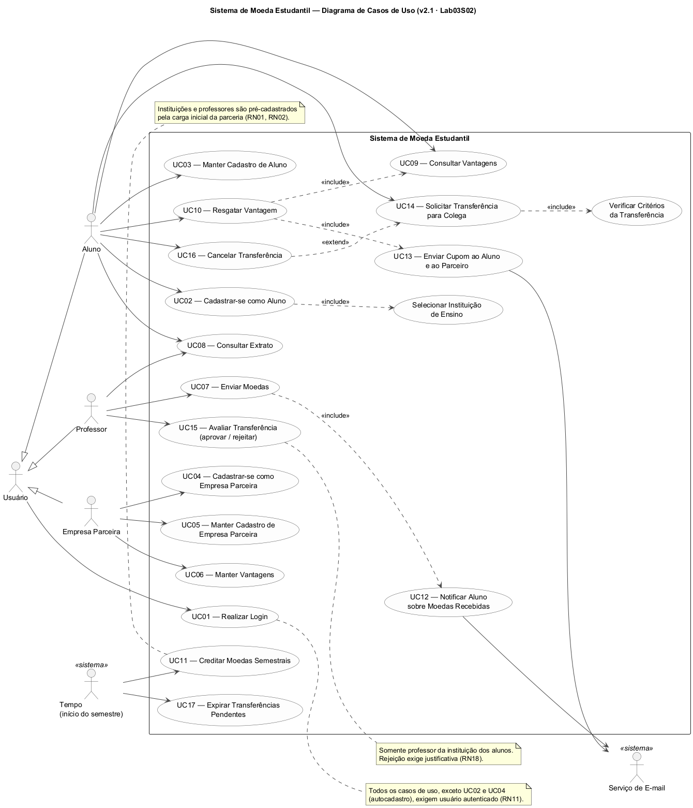
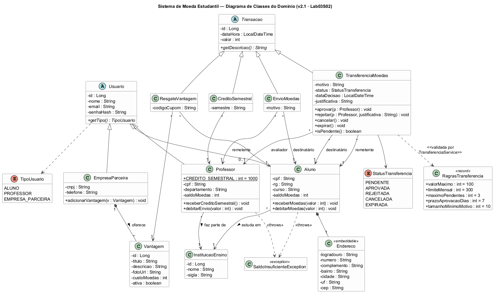
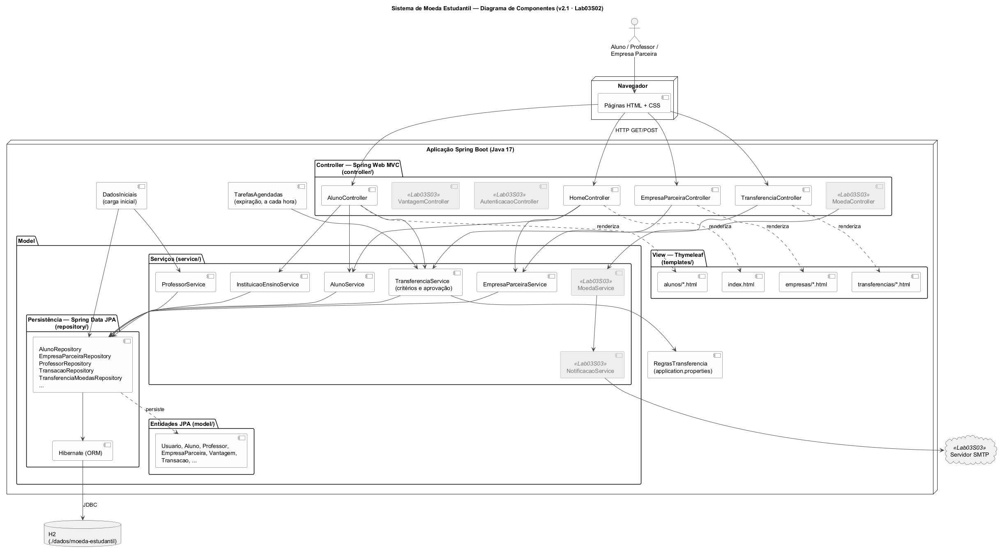
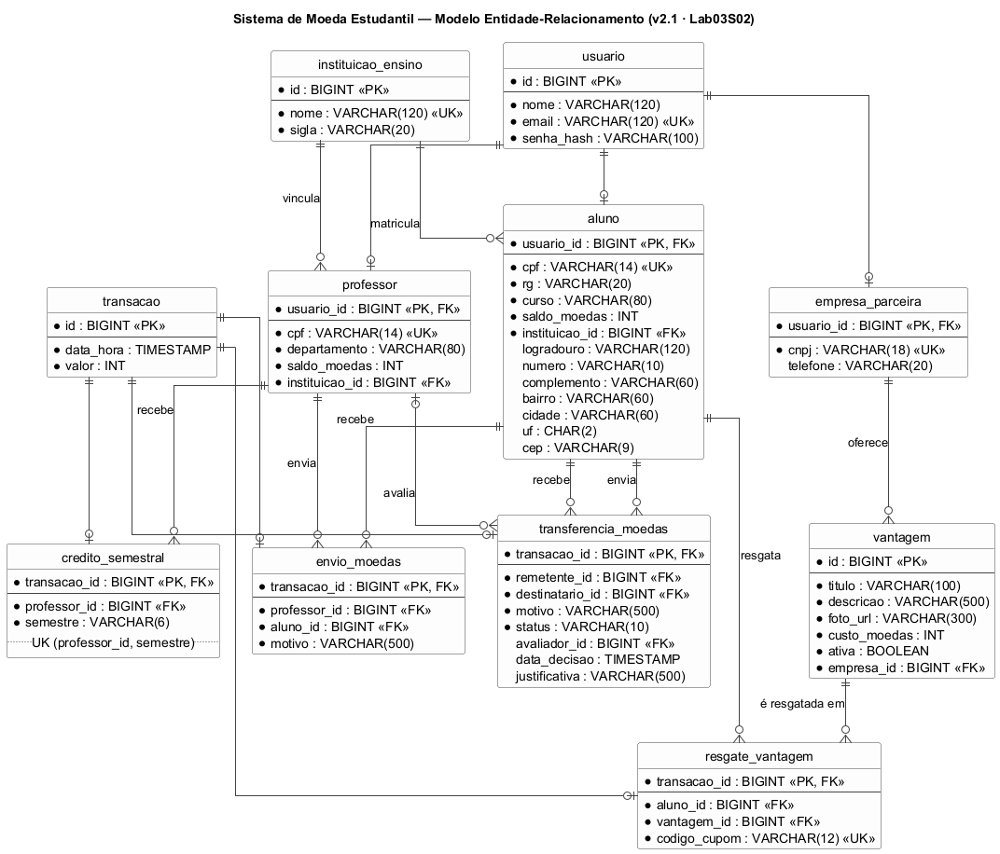
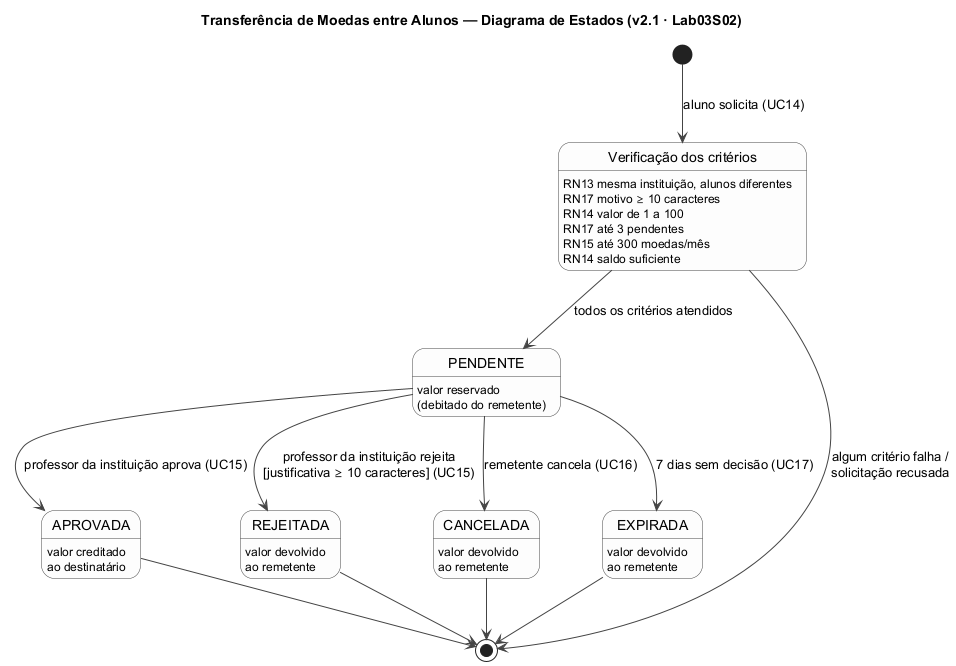

# Sistema de Moeda Estudantil — PUC Minas

**Laboratório de Desenvolvimento de Software — Laboratório 3 (2º Semestre/2026)**
Curso de Engenharia de Software — Prof. Glender Brás

Sistema para estimular o reconhecimento do mérito estudantil com uma moeda virtual. Professores
recebem moedas a cada semestre e as distribuem aos alunos como reconhecimento. Os alunos trocam
as moedas por vantagens (produtos e descontos) oferecidas por empresas parceiras.

> **Versão atual: v2.1 (Lab03S02 + novo requisito).** Além do modelo ER, da persistência com ORM
> (JPA/Hibernate + Spring Data) e dos CRUDs de aluno e de empresa parceira, os alunos agora podem
> **transferir moedas entre si, com aprovação de um professor** (ver [Seção 12](#12-transferência-de-moedas-entre-alunos-novo-requisito)).
> Veja o [histórico de versões](#versões-do-projeto).

---

## Sumário

- [Versões do Projeto](#versões-do-projeto)
- [1. Visão Geral](#1-visão-geral)
- [2. Atores](#2-atores)
- [3. Requisitos Funcionais](#3-requisitos-funcionais)
- [4. Requisitos Não Funcionais](#4-requisitos-não-funcionais)
- [5. Regras de Negócio](#5-regras-de-negócio)
- [6. Diagrama de Casos de Uso](#6-diagrama-de-casos-de-uso)
- [7. Casos de Uso](#7-casos-de-uso)
- [8. Histórias de Usuário](#8-histórias-de-usuário)
- [9. Diagrama de Classes](#9-diagrama-de-classes)
- [10. Diagrama de Componentes (Arquitetura MVC)](#10-diagrama-de-componentes-arquitetura-mvc)
- [11. Modelo Entidade-Relacionamento](#11-modelo-entidade-relacionamento)
- [12. Transferência de Moedas entre Alunos (novo requisito)](#12-transferência-de-moedas-entre-alunos-novo-requisito)
- [13. Estratégia de Acesso ao Banco de Dados](#13-estratégia-de-acesso-ao-banco-de-dados)
- [14. Como Executar e Testar](#14-como-executar-e-testar)
- [15. Estrutura do Repositório](#15-estrutura-do-repositório)
- [16. Registro de Alterações por Versão](#16-registro-de-alterações-por-versão)
- [17. Cronograma das Sprints](#17-cronograma-das-sprints)
- [18. Equipe](#18-equipe)

---

## Versões do Projeto

| Versão | Sprint | Entrega | Diagramas desta versão |
|---|---|---|---|
| **v1** | Lab03S01 | Casos de uso, histórias de usuário, diagrama de classes e diagrama de componentes | [`versoes/v1-lab03s01/`](docs/diagramas/versoes/v1-lab03s01/) |
| **v2** | Lab03S02 | Modelo ER, persistência (ORM + repositórios), CRUDs de aluno e empresa parceira (versão inicial) | [`versoes/v2-lab03s02/`](docs/diagramas/versoes/v2-lab03s02/) |
| **v2.1** | Lab03S02 | **Novo requisito:** transferência de moedas entre alunos, com critérios e aprovação de professor | [`docs/diagramas/`](docs/diagramas/) (versão atual) |

---

## 1. Visão Geral

- **Alunos** fazem o próprio cadastro (nome, e-mail, CPF, RG, endereço, instituição de ensino e
  curso), escolhendo uma das instituições participantes, que já estão pré-cadastradas.
- **Professores** são pré-cadastrados, porque a instituição envia a lista no momento da parceria.
  Cada professor tem nome, CPF e departamento, e faz parte de uma instituição.
- A cada semestre, cada professor recebe **1.000 moedas**, que se somam ao saldo que sobrou.
- Para **enviar moedas**, o professor precisa ter saldo suficiente, escolher o aluno e escrever o
  motivo do reconhecimento (obrigatório). O aluno é **notificado por e-mail**.
- Professores e alunos consultam o **extrato**: saldo atual e transações (envios, para o professor;
  recebimentos e trocas, para o aluno).
- **Empresas parceiras** se cadastram e cadastram **vantagens**, cada uma com descrição, foto e
  custo em moedas.
- Ao **resgatar uma vantagem**, o valor sai do saldo do aluno, e o sistema envia um e-mail de cupom
  ao aluno e outro à empresa, ambos com o mesmo **código gerado pelo sistema** para conferência na
  troca presencial.
- Alunos, professores e empresas precisam de **login e senha**, e todas as funcionalidades exigem
  autenticação.
- **(v2.1)** Os alunos podem **transferir moedas para colegas**. A transferência só se conclui
  depois que um professor da instituição a aprova, e precisa atender aos critérios da
  [Seção 12](#12-transferência-de-moedas-entre-alunos-novo-requisito).

## 2. Atores

| Ator | Descrição |
|---|---|
| **Usuário** | Generalização de Aluno, Professor e Empresa Parceira: qualquer pessoa com login e senha. |
| **Aluno** | Faz o próprio cadastro, recebe moedas, consulta o extrato, troca moedas por vantagens e transfere moedas a colegas. |
| **Professor** | Pré-cadastrado; recebe 1.000 moedas por semestre, envia moedas, consulta o extrato e aprova ou rejeita transferências entre alunos. |
| **Empresa Parceira** | Faz o próprio cadastro e cadastra as vantagens que oferece. |
| **Serviço de E-mail** *(sistema)* | Entrega as notificações de moedas recebidas e os cupons de resgate. |
| **Tempo** *(sistema)* | Dispara o crédito semestral das moedas dos professores e a expiração das transferências pendentes. |

## 3. Requisitos Funcionais

| Código | Requisito | Caso de uso | Sprint |
|---|---|---|---|
| RF01 | O sistema deve autenticar alunos, professores e empresas parceiras por e-mail e senha. | UC01 | S03 |
| RF02 | O aluno deve poder se cadastrar informando nome, e-mail, senha, CPF, RG, endereço, instituição e curso. | UC02 | **S02** |
| RF03 | O aluno deve escolher a instituição de ensino entre as pré-cadastradas. | UC02 | **S02** |
| RF04 | O aluno deve poder consultar, alterar e excluir o próprio cadastro. | UC03 | **S02** |
| RF05 | A empresa parceira deve poder se cadastrar informando nome, CNPJ, e-mail, senha e telefone. | UC04 | **S02** |
| RF06 | A empresa parceira deve poder consultar, alterar e excluir o próprio cadastro. | UC05 | **S02** |
| RF07 | A empresa parceira deve poder cadastrar, alterar e desativar vantagens (título, descrição, foto e custo). | UC06 | S03 |
| RF08 | O professor deve poder enviar moedas a um aluno, informando valor e motivo. | UC07 | S03 |
| RF09 | O aluno deve ser notificado por e-mail ao receber moedas. | UC12 | S03 |
| RF10 | Professores e alunos devem poder consultar o extrato (saldo e transações). | UC08 | S03 |
| RF11 | O aluno deve poder consultar as vantagens disponíveis. | UC09 | S03 |
| RF12 | O aluno deve poder resgatar uma vantagem, tendo o custo debitado do saldo. | UC10 | S03 |
| RF13 | No resgate, o sistema deve gerar um código e enviar e-mail de cupom ao aluno e e-mail de conferência à empresa. | UC13 | S03 |
| RF14 | O sistema deve creditar 1.000 moedas a cada professor no início de cada semestre. | UC11 | **S02** (carga inicial) |
| RF15 | Instituições e professores devem estar pré-cadastrados no sistema. | — | **S02** (carga inicial) |
| RF16 **(v2.1)** | O aluno deve poder solicitar a transferência de moedas para outro aluno, informando valor e motivo. | UC14 | **S02** |
| RF17 **(v2.1)** | O sistema deve verificar os critérios da transferência antes de aceitar a solicitação. | UC14 | **S02** |
| RF18 **(v2.1)** | Um professor da instituição deve poder aprovar ou rejeitar (com justificativa) as transferências pendentes. | UC15 | **S02** |
| RF19 **(v2.1)** | O aluno remetente deve poder cancelar uma transferência ainda pendente. | UC16 | **S02** |
| RF20 **(v2.1)** | O sistema deve expirar as transferências pendentes além do prazo e devolver o valor ao remetente. | UC17 | **S02** |

## 4. Requisitos Não Funcionais

| Código | Requisito |
|---|---|
| RNF01 | O sistema deve seguir a arquitetura **MVC** (Model, View, Controller). |
| RNF02 | O sistema deve ser uma aplicação web acessível por navegador, com layout que funcione em telas de celular. |
| RNF03 | Os dados devem ser persistidos em banco de dados relacional, acessado por ORM. |
| RNF04 | As senhas devem ser armazenadas apenas como hash (BCrypt), nunca em texto puro. |
| RNF05 | O back-end deve ser desenvolvido em Java 17 com Spring Boot. |
| RNF06 | O sistema deve validar os dados de entrada (CPF, CNPJ, e-mail, CEP, campos obrigatórios) e exibir as mensagens de erro junto ao campo. |
| RNF07 | O repositório deve manter todas as versões dos modelos UML. |

## 5. Regras de Negócio

| Código | Regra |
|---|---|
| RN01 | As instituições de ensino participantes são pré-cadastradas; o aluno apenas seleciona uma delas. |
| RN02 | Os professores são pré-cadastrados a partir da lista enviada pela instituição; todo professor pertence a uma instituição. |
| RN03 | A cada semestre, cada professor recebe 1.000 moedas, somadas ao saldo atual (o saldo é acumulável). Um mesmo semestre não é creditado duas vezes. |
| RN04 | Para enviar moedas, o professor deve ter saldo suficiente, e o motivo é obrigatório. O valor deve ser positivo. |
| RN05 | O valor enviado é debitado do professor e creditado ao aluno na mesma transação. |
| RN06 | E-mail, CPF (de aluno) e CNPJ são únicos no sistema. O e-mail é o login, único entre todos os tipos de usuário. |
| RN07 | Toda vantagem tem título, descrição, foto e custo em moedas maior que zero. |
| RN08 | O aluno só resgata uma vantagem se tiver saldo maior ou igual ao custo dela. |
| RN09 | O extrato do professor mostra os créditos semestrais e os envios; o do aluno, os recebimentos e os resgates. |
| RN10 | Cada resgate gera um código de cupom único, presente nos e-mails ao aluno e à empresa. |
| RN11 | Todas as funcionalidades, exceto o autocadastro de aluno e de empresa, exigem autenticação. |
| RN12 | Não é possível excluir um aluno que já tenha transações, nem uma empresa com vantagens já resgatadas, para preservar os extratos. |
| RN13 **(v2.1)** | A transferência só ocorre entre dois alunos **diferentes** da **mesma instituição de ensino**. |
| RN14 **(v2.1)** | Cada transferência vale de **1 a 100 moedas** e não pode passar do saldo do remetente. |
| RN15 **(v2.1)** | Um aluno transfere no máximo **300 moedas por mês**, somando as transferências pendentes e aprovadas. Rejeitadas, canceladas e expiradas não contam. |
| RN16 **(v2.1)** | Na solicitação, o valor sai do saldo do remetente e fica **reservado**. Na aprovação, vai para o destinatário. Na rejeição, no cancelamento ou na expiração, volta ao remetente. |
| RN17 **(v2.1)** | O motivo é obrigatório (mínimo de 10 caracteres), e cada aluno pode ter no máximo **3 solicitações pendentes** ao mesmo tempo. |
| RN18 **(v2.1)** | Somente um **professor da instituição dos alunos** pode aprovar ou rejeitar. A rejeição exige justificativa (mínimo de 10 caracteres). Uma transferência encerrada não pode ser decidida de novo. |
| RN19 **(v2.1)** | Somente o remetente pode cancelar, e apenas enquanto a transferência estiver pendente. |
| RN20 **(v2.1)** | A transferência pendente por mais de **7 dias** expira automaticamente. |

Os limites numéricos das RN14, RN15, RN17 e RN20 ficam em `application.properties`
(`moeda.transferencia.*`) e podem ser ajustados sem mudar o código.

## 6. Diagrama de Casos de Uso



Fonte PlantUML: [`docs/diagramas/casos-de-uso.puml`](docs/diagramas/casos-de-uso.puml)

## 7. Casos de Uso

| Código | Caso de uso | Ator(es) | Histórias |
|---|---|---|---|
| UC01 | Realizar Login | Aluno, Professor, Empresa Parceira | US01 |
| UC02 | Cadastrar-se como Aluno | Aluno | US02 |
| UC03 | Manter Cadastro de Aluno | Aluno | US03 |
| UC04 | Cadastrar-se como Empresa Parceira | Empresa Parceira | US04 |
| UC05 | Manter Cadastro de Empresa Parceira | Empresa Parceira | US05 |
| UC06 | Manter Vantagens | Empresa Parceira | US06 |
| UC07 | Enviar Moedas | Professor | US07 |
| UC08 | Consultar Extrato | Professor, Aluno | US08, US09 |
| UC09 | Consultar Vantagens | Aluno | US10 |
| UC10 | Resgatar Vantagem | Aluno | US11 |
| UC11 | Creditar Moedas Semestrais | Tempo | US12 |
| UC12 | Notificar Aluno sobre Moedas Recebidas | Serviço de E-mail | US07 |
| UC13 | Enviar Cupom ao Aluno e ao Parceiro | Serviço de E-mail | US11, US13 |
| UC14 **(v2.1)** | Solicitar Transferência para Colega (inclui Verificar Critérios) | Aluno | US14 |
| UC15 **(v2.1)** | Avaliar Transferência (aprovar / rejeitar) | Professor | US15 |
| UC16 **(v2.1)** | Cancelar Transferência (estende UC14) | Aluno | US16 |
| UC17 **(v2.1)** | Expirar Transferências Pendentes | Tempo | US17 |

## 8. Histórias de Usuário

**US01 — Login** (UC01)
Como **usuário** (aluno, professor ou empresa parceira), quero entrar no sistema com meu e-mail e
senha, para acessar as funcionalidades do meu perfil.
- Com e-mail e senha corretos, sou levado à página inicial do meu perfil.
- Com dados incorretos, vejo a mensagem "E-mail ou senha inválidos", sem indicar qual dos dois está errado.
- Sem login, qualquer página protegida me redireciona para a tela de login.

**US02 — Cadastro de aluno** (UC02)
Como **aluno**, quero me cadastrar informando nome, e-mail, senha, CPF, RG, endereço, instituição
de ensino e curso, para participar do sistema de mérito.
- A instituição é escolhida numa lista com as instituições pré-cadastradas.
- CPF e e-mail inválidos ou já cadastrados são recusados, com a mensagem junto ao campo.
- A senha tem pelo menos 6 caracteres e é gravada como hash.
- Após o cadastro, meu saldo inicial é 0 moedas.

**US03 — Manter cadastro de aluno** (UC03)
Como **aluno**, quero consultar, alterar e excluir meu cadastro, para manter meus dados corretos.
- Posso alterar todos os dados; deixar a senha em branco mantém a senha atual.
- Não posso excluir o cadastro se já recebi ou troquei moedas (RN12).

**US04 — Cadastro de empresa parceira** (UC04)
Como **empresa parceira**, quero me cadastrar informando nome, CNPJ, e-mail, senha e telefone, para
oferecer vantagens aos alunos.
- CNPJ e e-mail inválidos ou já cadastrados são recusados.

**US05 — Manter cadastro de empresa parceira** (UC05)
Como **empresa parceira**, quero consultar, alterar e excluir meu cadastro.
- Ao excluir, minhas vantagens também são removidas, desde que nenhuma tenha sido resgatada (RN12).

**US06 — Manter vantagens** (UC06)
Como **empresa parceira**, quero cadastrar vantagens com título, descrição, foto e custo em moedas,
para que os alunos possam trocá-las.
- Todos os campos são obrigatórios e o custo é maior que zero (RN07).
- Posso desativar uma vantagem; ela deixa de aparecer para os alunos, mas continua nos extratos.

**US07 — Enviar moedas** (UC07, UC12)
Como **professor**, quero enviar moedas a um aluno, informando o valor e o motivo, para reconhecer
o mérito dele.
- O envio é recusado se o valor for maior que meu saldo ou se o motivo estiver vazio (RN04).
- Meu saldo diminui e o do aluno aumenta no mesmo instante (RN05).
- O aluno recebe um e-mail com o valor, meu nome e o motivo.

**US08 — Extrato do professor** (UC08)
Como **professor**, quero ver meu saldo e a lista dos créditos semestrais e envios que fiz, com data,
aluno, valor e motivo.

**US09 — Extrato do aluno** (UC08)
Como **aluno**, quero ver meu saldo e a lista das moedas que recebi (com professor e motivo) e das
vantagens que resgatei (com código do cupom).

**US10 — Consultar vantagens** (UC09)
Como **aluno**, quero ver as vantagens ativas, com foto, descrição, empresa e custo, para escolher
o que trocar.

**US11 — Resgatar vantagem** (UC10, UC13)
Como **aluno**, quero trocar minhas moedas por uma vantagem e receber um cupom por e-mail, para
usá-lo na troca presencial.
- O resgate é recusado se meu saldo for menor que o custo (RN08).
- O custo é debitado do meu saldo, e recebo um e-mail com o código do cupom (RN10).

**US12 — Crédito semestral** (UC11)
Como **professor**, quero receber 1.000 moedas no início de cada semestre, somadas ao que sobrou do
semestre anterior (RN03).
- O crédito aparece no meu extrato e não é feito duas vezes no mesmo semestre.

**US13 — Conferência do cupom pela empresa** (UC13)
Como **empresa parceira**, quero receber um e-mail a cada resgate das minhas vantagens, com o código
do cupom e o nome do aluno, para conferir a troca presencial.

**US14 — Solicitar transferência** (UC14) **(v2.1)**
Como **aluno**, quero transferir moedas para um colega da minha instituição, informando valor e
motivo, para reconhecer uma ajuda que recebi.
- Só vejo como destinatários os colegas da minha instituição (RN13).
- Antes de solicitar, vejo meu saldo e quanto ainda posso transferir no mês.
- Valor fora de 1 a 100, acima do saldo ou do limite mensal, motivo curto ou mais de 3 pendentes:
  a solicitação é recusada com a mensagem do critério violado (RN14, RN15, RN17).
- Ao solicitar, o valor sai do meu saldo e fica reservado, e a transferência fica "Pendente" (RN16).

**US15 — Avaliar transferência** (UC15) **(v2.1)**
Como **professor**, quero ver as transferências pendentes dos alunos da minha instituição e aprovar
ou rejeitar cada uma, para evitar trocas de moedas sem mérito acadêmico.
- Ao aprovar, o valor é creditado ao destinatário.
- Para rejeitar, preciso escrever uma justificativa, e o valor volta ao remetente.
- Professores de outra instituição não podem decidir (RN18).
- Uma transferência já decidida não pode ser decidida de novo.

**US16 — Cancelar transferência** (UC16) **(v2.1)**
Como **aluno remetente**, quero cancelar uma transferência enquanto ela estiver pendente, para
recuperar as moedas reservadas (RN19).

**US17 — Expiração automática** (UC17) **(v2.1)**
Como **aluno remetente**, quero que uma transferência sem decisão em 7 dias expire sozinha e
devolva minhas moedas, para que elas não fiquem presas indefinidamente (RN20).

## 9. Diagrama de Classes



Fonte PlantUML: [`docs/diagramas/diagrama-classes.puml`](docs/diagramas/diagrama-classes.puml).
Corresponde ao pacote [`model`](src/main/java/br/pucminas/moedaestudantil/model/).

Decisões de modelagem:
- **`Usuario`** é abstrata e concentra o login (e-mail e senha); `Aluno`, `Professor` e
  `EmpresaParceira` a especializam.
- **`Transacao`** é abstrata e representa qualquer movimentação de moedas, que compõe o extrato.
  As três especializações são `EnvioMoedas` (professor → aluno), `ResgateVantagem` (aluno → vantagem)
  e `CreditoSemestral` (sistema → professor).
- As regras de saldo ficam nas próprias entidades (`Professor.debitarEnvio`, `Aluno.debitarMoedas`),
  que lançam `SaldoInsuficienteException`.

## 10. Diagrama de Componentes (Arquitetura MVC)



Fonte PlantUML: [`docs/diagramas/diagrama-componentes.puml`](docs/diagramas/diagrama-componentes.puml).
Os componentes em cinza serão implementados na Lab03S03.

| Camada MVC | Pacote / pasta | Tecnologia | Responsabilidade |
|---|---|---|---|
| **View** | `src/main/resources/templates/` | Thymeleaf + HTML/CSS | Páginas renderizadas no servidor |
| **Controller** | `controller/` | Spring Web MVC | Recebe as requisições HTTP, valida os formulários (`controller/form/`) e escolhe a view |
| **Model — serviços** | `service/` | Spring (`@Service`, `@Transactional`) | Regras de negócio e controle de transações |
| **Model — domínio** | `model/` | Entidades JPA | Estado e comportamento do domínio |
| **Model — persistência** | `repository/` | Spring Data JPA + Hibernate | Acesso ao banco (padrão Repository/DAO) |

## 11. Modelo Entidade-Relacionamento



Fonte PlantUML: [`docs/diagramas/modelo-er.puml`](docs/diagramas/modelo-er.puml).

- As duas hierarquias (`usuario` e `transacao`) usam a estratégia **JOINED**: uma tabela por classe,
  e a chave primária da tabela filha também é chave estrangeira para a tabela mãe. Assim o e-mail
  fica único entre todos os tipos de usuário (RN06), e o extrato é uma única consulta em `transacao`.
- `Endereco` é um `@Embeddable`: as colunas ficam na própria tabela `aluno`.
- `credito_semestral` tem chave única `(professor_id, semestre)`, que garante a RN03 também no banco.

## 12. Transferência de Moedas entre Alunos (novo requisito)

**Requisito:** os alunos precisam transferir moedas entre si, com um processo de aprovação e
critérios definidos.

**Como funciona:**

1. O aluno escolhe um colega da mesma instituição, o valor e o motivo (UC14).
2. O sistema verifica os critérios. Se algum falhar, a solicitação é recusada e a tela mostra qual
   critério não foi atendido.
3. Com os critérios atendidos, o valor **sai do saldo do remetente e fica reservado**, e a
   transferência fica **Pendente**. A reserva impede que o aluno gaste as mesmas moedas em outro
   resgate ou transferência enquanto espera.
4. Um **professor da instituição** aprova (o valor vai para o destinatário) ou rejeita com
   justificativa (o valor volta ao remetente) (UC15).
5. Enquanto a transferência está pendente, o remetente pode cancelar (UC16). Se ninguém decidir em
   7 dias, ela expira (UC17). Nos dois casos, o valor volta ao remetente.

**Critérios** (detalhados nas RN13–RN20 da [Seção 5](#5-regras-de-negócio)):

| # | Critério | Verificado em | Padrão |
|---|---|---|---|
| 1 | Remetente e destinatário são alunos diferentes | Solicitação | — |
| 2 | Os dois são da mesma instituição de ensino | Solicitação | — |
| 3 | Motivo com tamanho mínimo | Solicitação | 10 caracteres |
| 4 | Valor mínimo e máximo por transferência | Solicitação | 1 a 100 moedas |
| 5 | Número máximo de solicitações pendentes por aluno | Solicitação | 3 |
| 6 | Total transferido no mês (pendentes + aprovadas) | Solicitação | 300 moedas |
| 7 | Saldo suficiente | Solicitação | — |
| 8 | Avaliador é professor da instituição dos alunos | Aprovação / rejeição | — |
| 9 | Rejeição com justificativa | Rejeição | 10 caracteres |
| 10 | Só se decide uma transferência pendente, e uma única vez | Aprovação / rejeição / cancelamento | — |
| 11 | Só o remetente cancela | Cancelamento | — |
| 12 | Prazo para decisão | Tarefa agendada, a cada hora | 7 dias |

**Por que esses critérios:** a moeda representa mérito dado por professores. Os limites de valor,
total mensal e solicitações pendentes, junto com o motivo e a aprovação de um professor da mesma
instituição, evitam que as transferências virem um mercado paralelo de moedas ou uma forma de
concentrar o saldo de vários alunos em um só para resgatar vantagens caras.



Fonte PlantUML: [`docs/diagramas/diagrama-estados-transferencia.puml`](docs/diagramas/diagrama-estados-transferencia.puml).

**Onde está no código:**

| Camada | Arquivo |
|---|---|
| Model (entidade e estados) | [`TransferenciaMoedas`](src/main/java/br/pucminas/moedaestudantil/model/TransferenciaMoedas.java), [`StatusTransferencia`](src/main/java/br/pucminas/moedaestudantil/model/StatusTransferencia.java) |
| Model (critérios) | [`TransferenciaService`](src/main/java/br/pucminas/moedaestudantil/service/TransferenciaService.java), [`RegrasTransferencia`](src/main/java/br/pucminas/moedaestudantil/config/RegrasTransferencia.java) |
| Persistência | [`TransferenciaMoedasRepository`](src/main/java/br/pucminas/moedaestudantil/repository/TransferenciaMoedasRepository.java) |
| Controller | [`TransferenciaController`](src/main/java/br/pucminas/moedaestudantil/controller/TransferenciaController.java) |
| View | [`templates/transferencias/`](src/main/resources/templates/transferencias/) |
| Expiração automática | [`TarefasAgendadas`](src/main/java/br/pucminas/moedaestudantil/config/TarefasAgendadas.java) |

> Enquanto o login não existe (Lab03S03), o remetente e o professor avaliador são escolhidos na
> própria tela. Com o login, passam a ser o usuário autenticado. A notificação por e-mail das
> decisões entra junto com o `NotificacaoService` na Lab03S03.

## 13. Estratégia de Acesso ao Banco de Dados

**ORM com JPA/Hibernate + padrão Repository (Spring Data JPA).**

1. **Mapeamento objeto-relacional:** as entidades em `model/` são anotadas com JPA (`@Entity`,
   `@Inheritance(JOINED)`, `@ManyToOne`, `@Embedded`...). O Hibernate gera e atualiza o esquema
   (`spring.jpa.hibernate.ddl-auto=update`).
2. **Repositórios (DAO):** cada agregado tem uma interface em `repository/` que estende
   `JpaRepository`. O Spring Data gera a implementação em tempo de execução: as operações básicas
   (`save`, `findById`, `delete`) vêm prontas, consultas simples saem do nome do método
   (`existsByCpfAndIdNot`) e consultas específicas usam JPQL (`TransacaoRepository.extratoDoAluno`).
3. **Serviços transacionais:** os serviços (`@Transactional`) são a única camada que usa os
   repositórios. Os controllers nunca acessam o banco diretamente.
4. **Banco:** H2 em arquivo (`./dados/moeda-estudantil`), sem instalação. Para usar outro banco
   (PostgreSQL, MySQL), basta adicionar o driver e trocar `spring.datasource.*` em
   `application.properties`, sem mudar o código.
5. **Carga inicial:** [`DadosIniciais`](src/main/java/br/pucminas/moedaestudantil/config/DadosIniciais.java)
   cria as instituições e os professores pré-cadastrados (RN01, RN02) e faz o crédito do semestre
   atual (RN03), além de uma empresa e dois alunos de demonstração. Um deles já recebeu 200 moedas
   de um professor, para que dê para testar a transferência.

## 14. Como Executar e Testar

**Pré-requisito:** JDK 17 ou superior. O Maven vem embutido (Maven Wrapper).

```bash
# Windows
mvnw.cmd spring-boot:run
# Linux / macOS
./mvnw spring-boot:run
```

Acesse **http://localhost:8080**.

| Tela | URL |
|---|---|
| Início (professores e instituições pré-cadastrados) | `/` |
| Alunos: listar / cadastrar / detalhar / editar / excluir | `/alunos`, `/alunos/novo`, `/alunos/{id}`, `/alunos/{id}/editar` |
| Empresas parceiras: listar / cadastrar / detalhar / editar / excluir | `/empresas`, `/empresas/novo`, `/empresas/{id}`, `/empresas/{id}/editar` |
| Transferências: pendentes e histórico / nova / avaliar ou cancelar | `/transferencias`, `/transferencias/nova`, `/transferencias/{id}` |
| Console do banco H2 (JDBC URL `jdbc:h2:file:./dados/moeda-estudantil`, usuário `sa`, sem senha) | `/h2-console` |

Usuários da carga inicial (senha `123456`): `glender@pucminas.br` (professor),
`vinicius@aluno.pucminas.br` (aluno, 200 moedas), `larissa@aluno.pucminas.br` (aluna),
`contato@cantinace.com.br` (empresa). O login será ativado na Lab03S03. Para recriar o banco do
zero, apague a pasta `dados/`.

**Roteiro para demonstrar a transferência:** abra o aluno Vinícius em `/alunos` e clique em
*Transferir moedas* → escolha a Larissa, 50 moedas e um motivo → o saldo dele cai para 150
(reserva) → em `/transferencias`, clique em *Avaliar*, escolha o professor Glender e aprove → a
Larissa passa a ter 50 moedas. Para ver os critérios funcionando, tente 150 moedas, um motivo
curto ou um professor de outra instituição.

**Testes automatizados** (JUnit 5, banco H2 em memória):

```bash
mvnw.cmd test
```

São 31 testes. Cobrem o cadastro, a edição e a exclusão de aluno e de empresa, a unicidade de
e-mail, CPF e CNPJ, o hash da senha, o bloqueio de exclusão com transações, o crédito semestral
acumulável e não repetido, o saldo insuficiente e, em `TransferenciaServiceTest`, cada critério e
cada mudança de estado da transferência entre alunos (16 testes).

## 15. Estrutura do Repositório

```
├── docs/diagramas/                  # diagramas da versão atual (.puml, .png, .svg)
│   └── versoes/
│       ├── v1-lab03s01/             # diagramas da Sprint 1
│       └── v2-lab03s02/             # diagramas da Sprint 2, antes do novo requisito
├── src/main/java/br/pucminas/moedaestudantil/
│   ├── model/                       # entidades JPA (Model)
│   ├── repository/                  # repositórios Spring Data (persistência)
│   ├── service/                     # regras de negócio (Model)
│   ├── controller/                  # controllers Spring MVC (Controller)
│   │   └── form/                    # objetos de formulário com validação
│   └── config/                      # BCrypt, carga inicial, regras e tarefas agendadas
├── src/main/resources/
│   ├── templates/                   # páginas Thymeleaf (View)
│   ├── static/css/                  # estilos
│   └── application.properties
├── src/test/                        # testes automatizados
├── pom.xml, mvnw, mvnw.cmd          # build Maven
└── CHANGELOG.md
```

## 16. Registro de Alterações por Versão

### v1 — Lab03S01 (modelagem)
- Requisitos funcionais, não funcionais e regras de negócio levantados a partir do enunciado.
- Diagrama de casos de uso (UC01–UC13), histórias de usuário (US01–US13) com critérios de aceitação.
- Diagrama de classes do domínio e diagrama de componentes da arquitetura MVC, ainda sem tecnologias.

### v2 — Lab03S02 (persistência e CRUDs iniciais)
- **Modelo ER** novo, derivado do mapeamento JPA.
- **Estratégia de persistência** definida e implementada: JPA/Hibernate + Spring Data JPA + H2.
- **CRUDs de aluno e de empresa parceira** (front-end Thymeleaf integrado ao back-end), com validação
  de CPF, CNPJ, e-mail e CEP, unicidade e hash de senha.
- Carga inicial de instituições e professores, com crédito semestral.
- **Diagrama de classes atualizado:** `id` nas entidades; `senha` → `senhaHash`; `telefone` em
  `EmpresaParceira`; `ativa` em `Vantagem`; `SaldoInsuficienteException`; métodos de extrato e envio
  saíram das entidades e irão para a camada de serviço (`MoedaService`) na S03.
- **Diagrama de componentes atualizado:** tecnologias concretas e camada de persistência detalhada.
- Nova regra RN12 (exclusão bloqueada quando há transações), descoberta ao implementar a exclusão.

### v2.1 — Lab03S02 (novo requisito: transferência entre alunos)
- **Requisitos:** RF16–RF20 e regras RN13–RN20 (critérios e fluxo de aprovação).
- **Casos de uso:** UC14 (Solicitar, inclui *Verificar Critérios*), UC15 (Avaliar), UC16 (Cancelar,
  estende UC14) e UC17 (Expirar, ator Tempo). Histórias US14–US17.
- **Diagrama de classes:** nova `TransferenciaMoedas` (especialização de `Transacao`, com
  remetente, destinatário e professor avaliador), enumeração `StatusTransferencia` e
  `RegrasTransferencia`.
- **Modelo ER:** nova tabela `transferencia_moedas`.
- **Diagrama de componentes:** `TransferenciaController`, `TransferenciaService`,
  `TransferenciaMoedasRepository`, `RegrasTransferencia` e `TarefasAgendadas`.
- **Novo diagrama de estados** da transferência.
- **Código:** telas de transferência, transferências no detalhe do aluno, extrato do aluno e regra
  RN12 passam a considerar as transferências, e há 16 testes novos.
- Versão v2 dos diagramas preservada em `docs/diagramas/versoes/v2-lab03s02/`.

## 17. Cronograma das Sprints

| Sprint | Entregas | Situação |
|---|---|---|
| Lab03S01 | Casos de uso, histórias de usuário, diagrama de classes, diagrama de componentes | Concluída |
| Lab03S02 | Modelo ER, estratégia de persistência, CRUDs de aluno e empresa (versão inicial) + transferência entre alunos (novo requisito) | Concluída |
| Lab03S03 | CRUDs finais, login, vantagens, envio de moedas, extrato, resgate, e-mails, slides de arquitetura e persistência | A fazer |

## 18. Equipe

| Nome | GitHub |
|---|---|
| Vinícius Ramos | [@viniciusoramos](https://github.com/viniciusoramos) |
| *(adicionar integrantes)* | |
